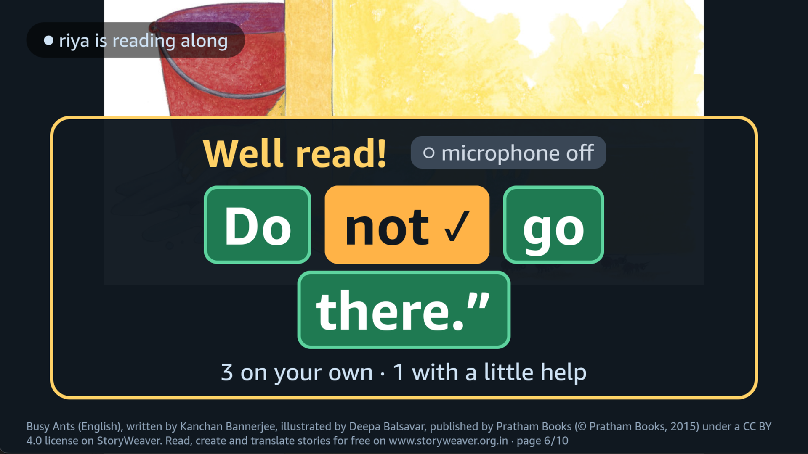
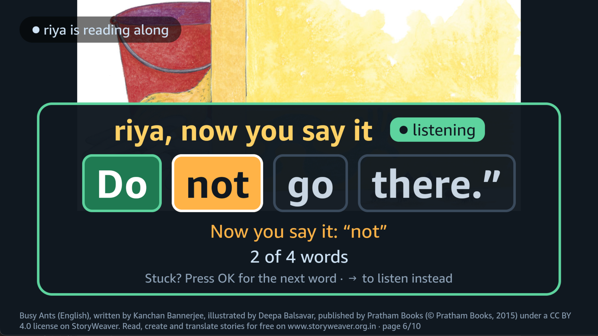
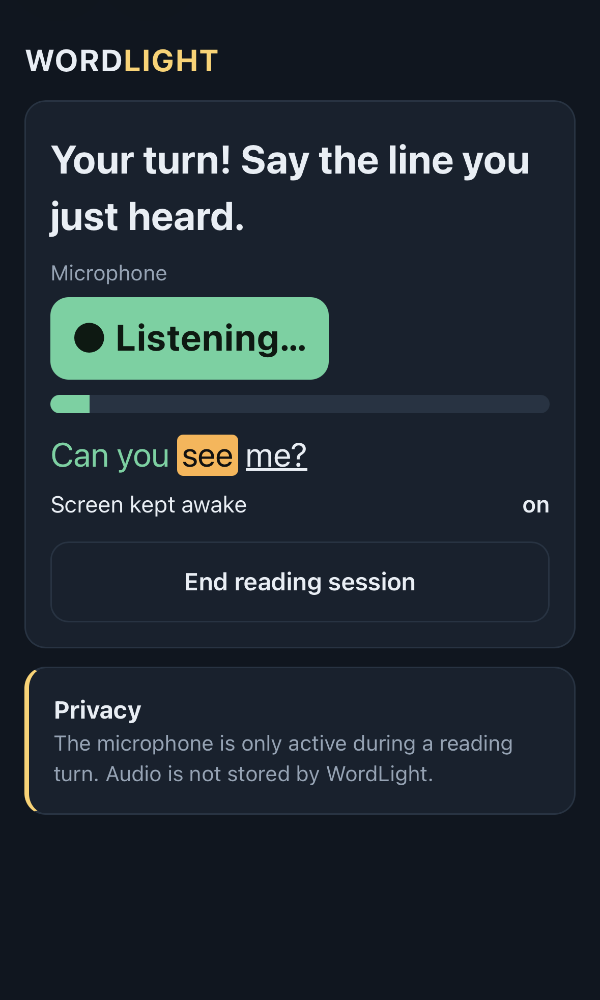
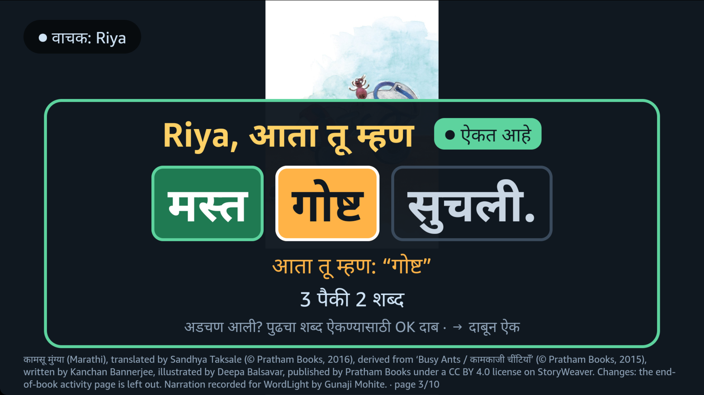
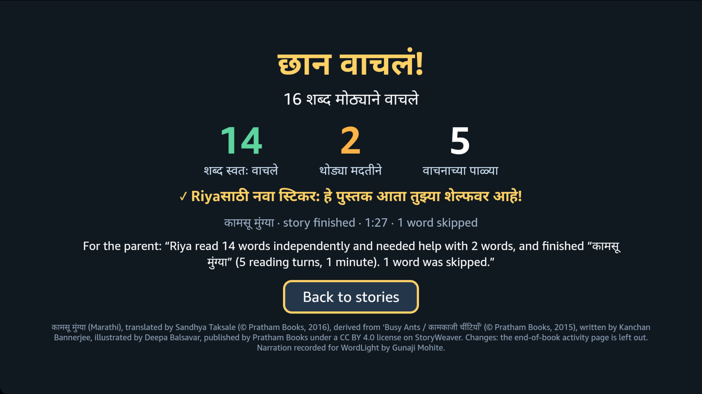
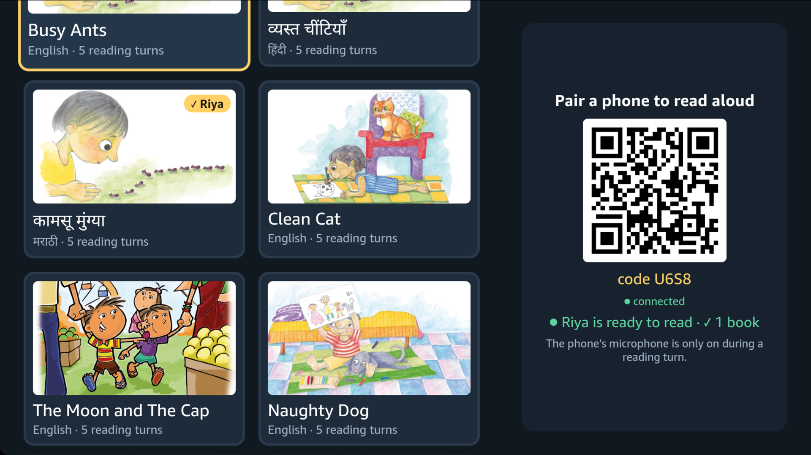

# WordLight

[](https://github.com/gunajii/wordlight/actions/workflows/test.yml)

> **The TV already has the words. WordLight teaches your child to read them.**

**▶ Demo video (2:52):** https://youtu.be/-5x0W25ymOw (a narrated intro, then a real session with a 6-year-old on the
Vega Virtual Device)

WordLight turns a family Fire TV into a reading stage for children aged about 6–10: the TV narrates an illustrated
story and lights each word as it is spoken; at a marked line it says **“Riya, now you say it”**, and the child reads
the line back into a paired phone. Amazon Transcribe hears the child, a strict reading engine lights the words she
actually says, and if she gets stuck the TV gently says the word — then gives her the chance to say it herself.
Nothing is ever marked wrong.

WordLight is designed around same-language subtitling
([UNESCO LitBase](https://www.uil.unesco.org/en/litbase/reading-billion-same-language-subtitling-india)).
**I have not measured any effect on children's reading and claim none.** Two children (ages 4 and 6) used
WordLight on 2026-10-12 with a parent present: **14 of 14 reading turns completed**, and the TV helped with 3 words
([results](docs/submission/MEASURED_RESULTS.md#children-2026-10-12-two-children-ages-4-and-6-a-parent-present)). The
6-year-old read the earlier 3–4 turns easily, which led to more turns by age.

> “This app is a really good way for Viraj to learn and revise his reading. Most of the time I am either unavailable or don't comprehend the exact words like the app might, which makes his learning better.”
> — Viraj's mother, 14 Oct 2026 (shared with permission; punctuation and grammar lightly edited, meaning unchanged)

## For judges: where the evidence is
| Criterion | What WordLight does | Evidence (labels: MEASURED / INFERRED / UNKNOWN) |
|---|---|---|
| **Technological implementation** | Vega OS app (React Native for Vega) · phone web page, no install · AWS server streaming the child's voice to **Amazon Transcribe** · deterministic reading engine for English, Hindi and Marathi | Spoken word → lit on the TV: **median 1.05 s** (93 words, 5 real sessions, adult; target ≤ 1 s just missed; Marathi: 1.11 s, 14 words) · narration ↔ highlight sync **median −1.0 ms** (Vega Virtual Device) · **236 tests**, run by GitHub Actions on every push — [MEASURED_RESULTS](docs/submission/MEASURED_RESULTS.md) |
| **Design** | Scan a QR → consent → reader. The TV reads a line, the child says it back, words light green; after a stall the TV says just the next word (amber) and lets the child repeat it; nothing is marked wrong. Turns follow the child's age. A finished book earns a sticker on the shelf (no scores). The parent's page speaks English, Hindi or Marathi | [Demo video](https://youtu.be/-5x0W25ymOw) · screenshots below · [privacy rules](docs/PRIVACY.md): microphone **only during a turn**, always shown on the phone — **0 violations in 1,392 status reports** (adult 1,045 + children 347; MEASURED) |
| **Potential impact** | Children about 6–10 reading with a parent on the family TV; English, Hindi and Marathi; open-licence picture books (StoryWeaver, CC BY) | **≈ USD 0.03 of Transcribe per reading session** (median of 7 real runs; narration costs nothing at play time) — [cost](docs/submission/MEASURED_RESULTS.md#cost-per-reading-session-real-aws-runs-2026-10-09-to-12) · two children (4 and 6) completed 14 of 14 turns, 0 microphone violations (MEASURED) · no learning effect claimed |
| **Quality of the idea** | Same-language subtitling (word-by-word highlighting) + echo reading on the screen families already watch together | Why Echo Mode: Transcribe lit only ≈ 51 % of words within 1 s (169 lines), so the TV reads first — [S2](docs/submission/MEASURED_RESULTS.md) |
| **AWS Builder** | Transcribe streaming · Polly (narration, help clips) · EC2 + CloudFormation · IAM role · S3 · DynamoDB (counts only) · Translate (parent's summary in 7 Indian languages, name masked; **worked in the app in Marathi**, MEASURED). Bedrock integrated but **not in use** (account not authorised) | [AWS_BUILDER](docs/submission/AWS_BUILDER.md) |
| **Open source** | [`karaoke-vega`](https://github.com/gunajii/karaoke-vega): word-timed subtitles for Vega (MIT) · `npm install github:gunajii/karaoke-vega` | [OPEN_SOURCE](docs/submission/OPEN_SOURCE.md) |
| **Friction log** | 21 entries on Vega and AWS (task → steps → expected → actual → severity → workaround → suggestion) | [FRICTION_LOG](docs/FRICTION_LOG.md) |

Limits I know of: tested on the Vega Virtual Device (physical Fire TV: UNKNOWN) · recognition takes ≈ 1 s · the child
reads in English, Hindi and Marathi only (Marathi tested by one adult) · two children so far, and no measure of learning.

| The child's turn on the TV | Help, then say it back | The phone during a turn |
|---|---|---|
|  |  |  |

| Marathi turn: help with one word | End card: a sticker, not a score | The sticker on the shelf |
|---|---|---|
|  |  |  |

## Why the TV, not a tablet
Reading-aloud tutors already exist on phones and tablets. WordLight puts the same idea on the screen a family shares:
- **Reading becomes family time.** The child reads to the TV with a parent beside them, not alone on one more personal
  screen.
- **Nothing to hand to a 6-year-old.** The phone stays with the parent as the microphone; the child follows big words
  on the TV from the sofa.
- **Made for Indian homes.** English, Hindi and Marathi stories from StoryWeaver's free library, a Hindi narrator and a
  recorded Marathi narrator, and a reading engine that handles Devanagari.
- **No new hardware.** A Fire TV app plus the phone the family already has.

## Languages: built to travel
- **Today:** the child reads in **English, Hindi and Marathi** (Amazon Transcribe en-IN / hi-IN / mr-IN, a reading
  engine that handles Devanagari). Marathi was added mostly as content: the official StoryWeaver translation of
  *Busy Ants* and a human narrator recorded in the browser, timed by Transcribe alignment (MEASURED: one adult session,
  5/5 turns). The parent's phone page itself can be shown in English, Hindi or Marathi. The parent's summary comes in **8 languages** (English, Hindi, Marathi, Bengali, Gujarati, Kannada,
  Tamil, Telugu) through Amazon Translate, with the child's name kept out of the request; Marathi was checked in the
  app on 2026-10-14 (MEASURED).
- **Adding a language is mostly content, not new code:** a free StoryWeaver book (CC BY), a narrator (Amazon Polly,
  or, where Polly has no voice, as for Marathi, a person recorded with `tools/content/make-recorder.ts` and timed by
  Amazon Transcribe alignment), and a language Amazon Transcribe can hear live. English, Hindi and Marathi reading are
  tested.
- **The reach (not a result):** StoryWeaver lists over 60,000 free stories in more than 300 languages
  ([IndiaFOSS 2025](https://fossunited.org/c/indiafoss/2025/cfp/9t90elof3d),
  [OE Global 2023](https://awards.oeglobal.org/awards/2023/open-repository/storyweaver/)), and Amazon Transcribe
  streams 99 language codes, more than 70 languages, 10 of them Indian besides English
  ([AWS docs](https://docs.aws.amazon.com/transcribe/latest/dg/supported-languages.html), checked 2026-10-14).

## How it works
1. **Pair:** the TV shows a QR code; a parent scans it (no app install), agrees to the microphone rule, and adds the
   reader (first name, age, language).
2. **Listen:** the story plays — Amazon Polly narration, each word lit on time (`@wordlight/karaoke-vega`).
3. **Your turn (Echo Mode):** the TV reads a line, stops, and the child says it back. Words light green as the child
   says them (≈ 1.1–1.2 s after each word — that is the speech recogniser's latency, measured).
4. **Help, not judgement:** after ≈ 3 s of quiet (sound such as a stutter keeps it waiting, up to 6 s) the TV says the
   next word from a slow, clear clip and marks it amber; the child can then say it back (✓) before the line moves on.
5. **Well read!** — the TV and the parent's phone show what really happened: words read on their own, words that
   needed a little help.

Why Echo Mode: my measurements showed Amazon Transcribe recognises ≈ 95 % of words but typically ~1 s after they
are spoken, too late for “the child reads first” (only ≈ 51 % lit within 1 s across 169 test lines). Hearing the line
first and then saying it is a deliberate guided-reading design, not a hidden fallback. Details:
[docs/submission/MEASURED_RESULTS.md](docs/submission/MEASURED_RESULTS.md).

## Stories
- **Busy Ants** (English) — Kanchan Bannerjee, illustrated by Deepa Balsavar, Pratham Books, CC BY 4.0, via
  StoryWeaver. Narrated by Amazon Polly's expressive (generative) Kajal voice.
- **व्यस्त चींटियाँ** (Hindi) — my own unofficial translation of Busy Ants (CC BY 4.0), narrated by Polly neural Kajal.
- **Naughty Dog** (English) — Kanchan Bannerjee, illustrated by Deepa Balsavar, Pratham Books, CC BY 4.0, via
  StoryWeaver (same “Animals Around Us” series). Expressive Kajal voice; three reading turns chosen by hand (common words, no names).
- **Noisy Crows** and **Clean Cat** (English) — Kanchan Bannerjee, illustrated by Deepa Balsavar, Pratham Books,
  CC BY 4.0, via StoryWeaver (“Animals Around Us” series). Expressive Kajal voice.
- **The Moon and The Cap** (English) — Rohini Nilekani, illustrated by Angie & Upesh, Pratham Books, CC BY 4.0, via
  StoryWeaver. Expressive Kajal voice.
Credits are shown in the app and in [docs/CONTENT.md](docs/CONTENT.md).

**Reading turns follow the child's age** (set on the phone): 5 lines at age 5 and one more per year, up to 12 at
age 12, with longer lines only for older readers (7 words at age 5, up to 12 words from age 10). A story offers what
it has: *Naughty Dog* stops at 9, because lines with the names “Chinku”, “Ma” and “papads” are kept out (a recogniser
is likely to mishear them). Set on 2026-10-12 after a 6-year-old read the earlier 3–4 turns easily.

## What is real and what was measured (2026-10-09 to 14)
| | Result | Label |
|---|---|---|
| Narration ↔ highlight sync on the Vega Virtual Device (S1) | median −1.0 ms, SD 11 ms after calibration | MEASURED (VVD). Physical Fire TV: UNKNOWN |
| Phone microphone streaming (S3, iPhone + Android) | ≈ 52 000 chunks, 0 lost; capture → server 50–90 ms | MEASURED |
| Polly word timing (S4) | 53 % of words within 50 ms (target 95 %) — **FAIL**; English now uses the generative voice with Transcribe-aligned timings (median 40 ms vs 52 ms) | MEASURED |
| Transcribe in the reading loop (S2, 169 lines, synthetic adult voice) | ≈ 95 % recognised, 51 % within 1 s — **FAIL for free reading** → Echo Mode | MEASURED |
| Real loop: phone → AWS → Transcribe → TV (adult tester) | word lit a median 1.05 s after spoken (n = 93, 5 sessions); target ≤ 1 s not met | MEASURED |
| Help recovery (next word helped too early) | 1/20 → 0/20 after the fix (synthetic reader, real Transcribe) | MEASURED |
| Privacy audit on AWS | 0 violations in 891 microphone reports (5 sessions); mic off 8–107 ms after each turn end | MEASURED |
| Children (2026-10-12) | two children, 4 and 6, parent present: 14/14 turns completed; 48 words lit a median 1.15 s after spoken; 0 microphone violations | MEASURED · learning effect: not measured |
| Parent's summary in Marathi (Amazon Translate, 2026-10-14) | first try fell back to English (Translate spelled the name placeholder in Marathi letters; friction log W20); after the fix, Marathi with the name kept, plus the reading diary | MEASURED (one adult session, phone recording) · translation quality not reviewed |
| First Marathi reading (2026-10-14, *कामसू मुंग्या*, recorded human narrator, Transcribe mr-IN) | 5/5 turns, 14 on own · 2 helped · 1 skipped; word lit a median 1.11 s after spoken (n = 14); 154 microphone reports, 0 violations; sticker on the shelf afterwards | MEASURED (one adult) · children reading Marathi: UNKNOWN |

## Run it
Needs Node ≥ 22.18; the TV app needs the Vega SDK (macOS).
```bash
git clone https://github.com/gunajii/wordlight && cd wordlight
npm install && npm test        # 236 tests, no AWS needed
npm run demo:check             # headless loop with a LOCAL SIMULATION of speech (labelled SIMULATED)

# TV app (macOS + Vega SDK 0.24): generate the Vega project once, then build + launch on the Virtual Device
bash apps/vega-tv/setup.sh
npm run demo:local             # local server + scripted reader (SIMULATED speech), then in a second terminal:
bash tools/vvd/run-tv.sh

# the real path (needs your AWS account): deploy once, then each demo starts the server, runs, and stops it
bash infra/aws/deploy.sh
bash tools/demo/real-demo.sh   # AWS server + Amazon Transcribe + Vega Virtual Device + your phone
```
AWS: `bash infra/aws/deploy.sh` (CloudFormation + SSM), checks with `node tools/ops/healthcheck.ts https://<host>`.
Measurement scripts: `tools/aws/phase-*.sh`. Everything simulated is labelled SIMULATED on screen and in reports.

## Repository
| Path | What |
|---|---|
| `apps/vega-tv/` | Vega TV app (React Native for Vega): shelf, story player, Your Turn, help, end card, diagnostics (↑) |
| `web/phone/` | Phone page: consent, reader, microphone during turns only, summary |
| `server/` | Session server: pairing, events, Transcribe pipeline, voice activity, reading driver, summary, DynamoDB progress |
| `packages/reading-engine` | Deterministic, strict matcher (Hindi/English), stall/help/say-it-back rules |
| `packages/tv-core` | Your Turn state machine, playback plan (echo stop points), child-facing text (English/Hindi) |
| `packages/story-package` | Story format, validator, SSML narration mapping, turn-line choice |
| `oss/karaoke-vega` | **Open source:** `@wordlight/karaoke-vega` — word-timed subtitles for Vega (MIT), also at github.com/gunajii/karaoke-vega |
| `tools/` | Content pipeline (StoryWeaver → Polly → story package), measurement harnesses (S1–S4, help recovery, e2e) |
| `infra/aws/` | CloudFormation, deploy, start/stop, cost guard, least-privilege policy |
| `docs/` | Architecture, privacy, security, measured results, friction log (W1–W19), Hindi review, submission texts |
| `content/stories/` | The three demo stories with their built media (see THIRD_PARTY_NOTICES.md) |

## Privacy
The phone microphone is on **only during a reading turn**, after a parent agrees, and the phone always shows it.
Audio goes only to the WordLight server on AWS (HTTPS) and on to Amazon Transcribe; WordLight stores no audio and no
transcript text — only counts. [docs/PRIVACY.md](docs/PRIVACY.md) · [docs/SECURITY.md](docs/SECURITY.md)

## Licence and attribution
Code: MIT (`LICENSE`). Stories CC BY 4.0 (Pratham Books / StoryWeaver; Hindi translation mine), narration generated
with Amazon Polly, Noto Sans Devanagari under SIL OFL — details in [THIRD_PARTY_NOTICES.md](THIRD_PARTY_NOTICES.md).
Code reused from the author's Earshot project: [docs/REUSED.md](docs/REUSED.md).
